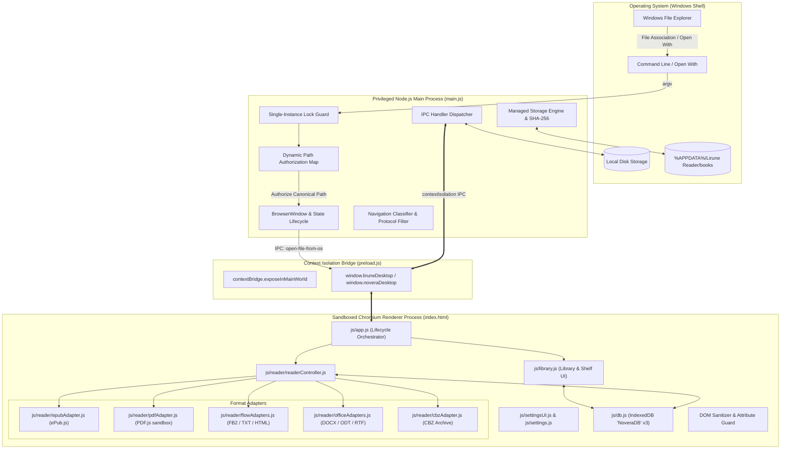
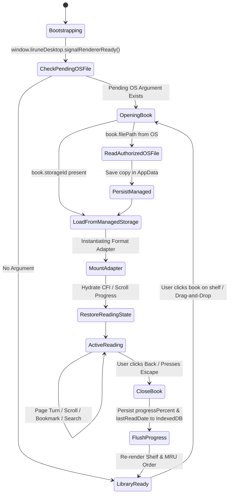

# Lirune Reader Windows Desktop Application
## Complete Architecture & End-to-End Core Logic Specification

---

## 1. Executive Summary & Design Principles

**Lirune Reader** (Desktop v5.6.1) is a private, local-first, offline-by-design desktop e-book reading application built on **Electron 44** and **Node.js 20**. It is architected specifically for Windows (10/11) with native shell integration, custom frameless window styling, and an isolated multi-format rendering engine.

### Core Architectural Principles
1. **Zero Telemetry & Strict Offline Execution:** No network calls, analytics, telemetry pings, or cloud account requirements. All book files, metadata, reading positions, and annotations remain strictly on the local machine.
2. **Multi-Format Unified Experience:** Seamless reading across **EPUB, PDF, DOCX, CBZ, FB2, RTF, ODT, TXT, and HTML** through a unified reader shell with persistent progress and annotations.
3. **Defense-in-Depth Security Model:** Complete separation between the privileged operating system process (Electron Main) and the sandboxed presentation process (Chromium Renderer), linked strictly via context-isolated, cryptographically validated IPC channels.
4. **Content-Addressable Managed Storage:** Every imported book is fingerprinted via SHA-256 and stored in user AppData under an immutable identity, ensuring deduplication and non-destructive file lifecycles.
5. **Continuous & Paginated Fluid Reading:** Dual-mode layout engine supporting both traditional paginated page-turns and smooth, infinite-scrolled reading with real-time viewport progress computation.

---

## 2. Process Architecture & Trust Boundaries

The application follows the Electron multi-process model with hard security sandboxing:



### Security Isolation Enforcements
* **`nodeIntegration: false`:** Direct Node.js APIs (`require`, `process`, `Buffer`, `fs`) are completely disabled in the renderer window.
* **`contextIsolation: true`:** The preload script runs in an isolated execution context, preventing web page scripts from tampering with IPC bridges or prototype chains.
* **`sandbox: true`:** The renderer process runs inside the Chromium OS-level sandbox with restricted system privilege.
* **`webSecurity: true`:** Same-Origin Policy and local file access restrictions are strictly enforced.
* **Permission Request Block:** `session.defaultSession.setPermissionRequestHandler` and `setPermissionCheckHandler` unconditionally return `false`, rejecting microphone, camera, geolocation, notification, and sensor requests.
* **Shell URL Navigation Guard (`classifyNavigation` & `will-navigate`):**
  * `index.html` via `file://` is the **only** permitted navigation target for the main window.
  * Top-level `will-navigate` unconditionally cancels (`event.preventDefault()`) all external redirects from untrusted book content, preventing auto-launching external browser windows without explicit user intent.
  * Explicit external web links intercepted via `setWindowOpenHandler` or the scoped `shell:open-external` IPC bridge are validated with the URL API (`isValidExternalHttpUrl`), allowing only `http:` and `https:` schemes without userinfo/credentials.
  * Arbitrary local schemes, directory browsing, or remote injections are denied with `event.preventDefault()`.

---

## 3. Main Process Core Logic (`main.js`)

The Main process owns the application lifecycle, native Windows integration, and filesystem security.

### 3.1 Single Instance Lock & Argument Extraction
When a user launches Lirune Reader or double-clicks a book in Windows Explorer:
```javascript
const gotTheLock = app.requestSingleInstanceLock();
if (!gotTheLock) {
  app.quit();
} else {
  app.on('second-instance', (event, argv) => {
    // Bring window to focus and open incoming book
  });
}
```
* **Argument Sanitization (`extractBookArg`):** Inspects incoming process arguments, strips wrapping shell quotation marks, discards Electron flags (`--inspect`, `-psn`), filters against supported extensions, and verifies via `fs.existsSync` and `fs.statSync` that the target is a real file.

### 3.2 Dynamic Path Authorization & Trusted Sender Validation
To prevent a compromised renderer or DOM script from reading arbitrary files from the user's filesystem (such as `C:\Windows\System32` or user documents), Lirune enforces **Trusted Sender Verification** and an **Authorization Map with Point-of-Consumption TTL Checking**:
```javascript
const pendingBookReadPaths = new Map();
const PENDING_PATH_TTL_MS = 5 * 60 * 1000; // 5 minutes
```
1. **Trusted-Sender Verification (`requireTrustedSender`):** Every privileged IPC handler inspects `event.senderFrame.url`, verifying it matches the canonical `EXPECTED_SHELL_URL` (`index.html`). IPC calls from unexpected or rogue frames are rejected immediately.
2. **Authorization:** When a book is opened via OS CLI, double-click, file association, native file dialog (`dialog:open-files`), or folder scan (`dialog:open-folder`), the absolute canonical path is added to `pendingBookReadPaths` with the current timestamp. The renderer cannot authorize arbitrary paths.
3. **Point-of-Consumption Expiration & One-Time Token (`consumeAuthorizedBookPath`):** When the renderer requests `fs:read-book`:
   * The path is matched against `pendingBookReadPaths`.
   * The entry is deleted immediately (one-time consumption enforced; duplicate reads fail).
   * The timestamp is checked at the exact moment of consumption: if `Date.now() - timestamp > PENDING_PATH_TTL_MS`, access is **denied immediately**, throwing `"This file was not opened by the operating system"`.
4. **Revocation:** Once read or if canceled, the path is revoked and removed from the map.

### 3.3 Managed AppData Storage Engine & Resource Limits
To protect book contents from accidental external deletion or relocation by the user, Lirune copies imported books into its isolated application directory:
* **Storage Location:** `%APPDATA%\Lirune Reader\books\` (resolved via `app.getPath('userData')`).
* **Content Addressability:** Every book receives an immutable filename based on the SHA-256 digest of its contents:
  $$\text{Storage ID} = \text{SHA256}(\text{fileBuffer}) + \text{"."} + \text{extension}$$
* **Resource Bounds:**
  * Maximum book file size: **512 MB** (`MAX_BOOK_FILE_SIZE`).
  * Maximum ZIP archive entries: **10,000** (`MAX_ZIP_ENTRIES`).
  * Maximum single entry uncompressed size: **64 MB** (`MAX_ZIP_SINGLE_ENTRY_SIZE`).
  * Maximum aggregate uncompressed archive size: **512 MB** (`MAX_ZIP_AGGREGATE_BYTES`).
  * Maximum folder import batch size: **2,000 books** (`MAX_FOLDER_IMPORT_FILES`).
  * Zip Slip path traversal rejection: any entry with `..`, leading `/` or `\\`, or null bytes is rejected before extraction.
* **Atomic Non-Destructive Write (`writeManagedBook`):**
  1. If a file with the storage ID already exists on disk, its SHA-256 fingerprint is verified. If identical, the write is a no-op (deduplication).
  2. If new, the buffer is written to a temporary file (`${destination}.${pid}.${timestamp}.tmp`) with the exclusive flag `wx`.
  3. The file is atomically renamed to its permanent storage ID via `fs.renameSync`. On failure, the temporary file is cleaned up safely.

### 3.4 Windows Registry File Associations (`ensureWindowsRegistryAssociation`)
When running as a packaged executable, Lirune automatically configures user-level Windows Registry keys in `HKCU\Software\Classes` without requiring administrator privileges:
* Registers ProgID: `Lirune.epub` with default icon pointing to the executable.
* Maps `HKCU\Software\Classes\.epub\OpenWithProgids` to `Lirune.epub`.
* Registers shell open command: `"${process.execPath}" "%1"`.
* Registers in `HKCU\Software\RegisteredApplications` under Windows Default Programs.

---

## 4. Preload Security Bridge (`preload.js`)

The preload script establishes the strictly validated `liruneDesktop` API in the renderer's `window` object using `contextBridge.exposeInMainWorld`:

| Channel Name | IPC Pattern | Purpose |
| :--- | :--- | :--- |
| `openFileDialog` | `invoke('dialog:open-files')` | Opens native Windows file picker filtered by book types |
| `openFolderDialog` | `invoke('dialog:open-folder')` | Recursively scans folder for supported books |
| `showInExplorer` | `invoke('shell:show-in-folder')` | Reveals managed book file in Windows File Explorer |
| `saveBookToStorage`| `invoke('fs:save-book')` | Persists file buffer into AppData managed storage |
| `readBookFile` | `invoke('fs:read-book')` | Consumes authorized OS file path and returns ArrayBuffer |
| `readManagedBook` | `invoke('fs:read-managed-book')`| Reads book from managed storage by storage ID |
| `inspectManagedBook`| `invoke('fs:inspect-managed-book')` | Verifies disk presence, byte size, and SHA-256 hash |
| `deleteOrphanFiles`| `invoke('fs:delete-orphan-files')` | Safely cleans unreferenced files from AppData |
| `minimizeWindow` | `send('window:minimize')` | Minimizes frameless window |
| `maximizeWindow` | `send('window:maximize')` | Toggles window maximize/restore |
| `closeWindow` | `send('window:close')` | Saves window bounds and exits application |
| `toggleNativeFullscreen` | `invoke('window:toggle-fullscreen')` | Toggles true native OS fullscreen |
| `onOpenFile` | `on('open-file-from-os')` | Event listener for incoming OS file associations |
| `signalRendererReady` | `invoke('app:signal-renderer-ready')` | Signals readiness to receive pending launch books |

---

## 5. Local Database & State Persistence Engine (`js/db.js`)

All structured data is stored in the browser's high-performance local **IndexedDB** database named **`NoveraDB` (Version 3)**.

```
NoveraDB (IndexedDB v3)
 ├── books (keyPath: 'id')
 │    ├── Indexes: [dateAdded, lastReadDate, title, fingerprint, storageId, favorite]
 │    └── Schema: {
 │          id: string (UUID),
 │          title: string,
 │          author: string,
 │          description: string,
 │          format: 'epub' | 'pdf' | 'docx' | 'cbz' | 'fb2' | 'rtf' | 'odt' | 'txt' | 'html',
 │          storageId: string ("<hash>.<ext>"),
 │          fingerprint: string (SHA-256 hex),
 │          fileSize: number,
 │          dateAdded: number (timestamp),
 │          lastReadDate: number (timestamp),
 │          progressPercent: number (0 - 100),
 │          currentLocation: string (CFI or section ID),
 │          currentChapter: string,
 │          chapterCount: number,
 │          coverDataUrl: string (validated data URI),
 │          favorite: boolean
 │        }
 ├── annotations (keyPath: 'id')
 │    ├── Indexes: [bookId, dateAdded, type]
 │    └── Schema: { id, bookId, type ('highlight'|'note'|'bookmark'), cfi, text, note, color, dateAdded }
 ├── preferences (keyPath: 'key')
 │    └── Key-value storage for reader settings (theme, font, margins, spacing, zoom)
 └── collections (keyPath: 'id')
      ├── Indexes: [name, dateCreated]
      └── Schema: { id, name, description, bookIds: string[], dateCreated }
```

### Self-Healing & Legacy Migration Protocol
On database open (`openDB`), the engine automatically executes `migrateLegacyBooks()`:
1. Detects records created prior to content-addressable storage that used raw filesystem paths.
2. Derives safe format extensions and validates storage identities.
3. Automatically fixes missing indices and cleans corrupted metadata records without data loss.

---

## 6. Multi-Format Ingestion & Parsing Pipeline

The application features a format-neutral ingestion pipeline managed by `js/formats.js` and `js/library.js`:

```mermaid
flowchart TD
    File[Input File: ArrayBuffer] --> Sniff[Content-Based Signature Sniffer]
    
    Sniff -->|Magic 50 4B 03 04 & container.xml| EPUB[EPUB Parser]
    Sniff -->|Magic %PDF-| PDF[PDF.js Parser]
    Sniff -->|Magic 50 4B 03 04 & word/document.xml| DOCX[DOCX OpenXML Parser]
    Sniff -->|Magic 50 4B 03 04 & comic images| CBZ[CBZ Comic Archive]
    Sniff -->|XML <FictionBook> root| FB2[FictionBook 2.0 Parser]
    Sniff -->|Magic 50 4B 03 04 & mimetype application/vnd.oasis...| ODT[OpenDocument Text]
    Sniff -->|Header {\rtf| RTF[Rich Text Format Parser]
    Sniff -->|HTML tags / Plaintext| TXT[TXT / HTML Stream]

    EPUB --> EPUB_Meta[Extract OPF metadata & cover]
    PDF --> PDF_Meta[Extract Title, Pages & Render Page 1 Cover via Canvas]
    DOCX --> DOCX_Meta[Extract docProps/core.xml & media/image1 cover]
    CBZ --> CBZ_Meta[Extract First Raster Image as Cover]
    FB2 --> FB2_Meta[Extract <title-info> & <coverpage> base64]
    ODT --> ODT_Meta[Extract meta.xml & Thumbnails/thumbnail.png]
    RTF --> RTF_Meta[Parse title from control words]
    TXT --> TXT_Meta[Auto-derive title from first non-empty lines]

    EPUB_Meta & PDF_Meta & DOCX_Meta & CBZ_Meta & FB2_Meta & ODT_Meta & RTF_Meta & TXT_Meta --> Validation[Validate Metadata & Cover URL]
    Validation --> Persist[Persist to Managed Storage & NoveraDB]
```

### 6.1 Format-Specific Parsing Specifications

#### 1. EPUB (`epubLoader.js` & `epubAdapter.js`)
* **DRM Protection Detection:** Checks for `META-INF/rights.xml` and `META-INF/encryption.xml`. If detected, ingestion halts safely with `"DRM-protected EPUBs are not supported"`.
* **Spine & Manifest Resolution:** Reads `META-INF/container.xml` to locate the `.opf` package file. Extracts manifest items, spine reading order, and NCX (`toc.ncx`) or EPUB3 Navigation Document (`nav.xhtml`).
* **Cover Extraction:** Resolves `<meta name="cover" content="...">` or `<item properties="cover-image">`, reads raw binary stream, and converts to a local data URL.
* **Rendering Engine:** Built on **ePub.js 0.3.93**. Renders chapters inside an isolated sandboxed `<iframe>`. Synchronizes progress via Canonical Fragment Identifiers (CFI).

#### 2. PDF (`pdfAdapter.js` & `pdfjs-loader.js`)
* **Rendering Engine:** Built on vendored, offline **PDF.js v4.0.379**.
* **Page Virtualization:** Renders only visible pages plus a 2-page buffer using HTML5 `<canvas>` elements and an SVG text-selection layer.
* **Cover Extraction:** Loads Page 1, renders it to an offscreen canvas at $0.8$ quality JPEG, and caches it as `coverDataUrl`.

#### 3. FictionBook 2.0 (`flowAdapters.js` & `js/library.js`)
* **XML Architecture:** Parses UTF-8/Windows-1251 FB2 XML via browser `DOMParser`.
* **Cover Extraction Security:** Inspects `<coverpage> <image href="#coverId">`. Locates `<binary id="coverId" content-type="...">`. Enforces that `content-type` is strictly in `['image/jpeg', 'image/png', 'image/gif', 'image/webp']` and verifies that the payload contains valid base64 characters before constructing `data:${contentType};base64,...`.
* **Sanitization:** Converts FB2 section AST into HTML `<section>`, `<h1>`-`<h6>`, `<p>`, and `<blockquote>`, stripping scripts and unknown attributes.

#### 4. Microsoft Word DOCX (`officeAdapters.js` & `js/library.js`)
* **Container:** Unzips DOCX package using `JSZip`.
* **Content Extraction:** Parses `word/document.xml`. Translates `<w:p>` to paragraphs, `<w:r>` to runs, `<w:b>` to bold, `<w:i>` to italic, and `<w:tbl>` to styled HTML tables.
* **Hyperlink Security Policy:** Resolves relationships in `word/_rels/document.xml.rels`. External links are validated to allow only `http:`, `https:`, and `mailto:`. Any `file://`, `javascript:`, or OS executable link is stripped and rendered as plain inert text.

#### 5. Comic Book Archive CBZ (`cbzAdapter.js` & `js/library.js`)
* **Image Discovery:** Scans ZIP entries, natural-sorts image filenames (`001.jpg`, `002.jpg`), filters supported formats (`jpg`, `png`, `webp`, `gif`), and extracts images on demand.
* **Continuous Comic Mode:** Renders pages in an infinite vertical roll with automatic width scaling and double-page spread detection.

---

## 7. Renderer UI Architecture & Core Application Logic

The renderer application is orchestrated by three foundational modules:

```
js/
 ├── app.js             // Lifecycle, Navigation, OS File Dispatcher, Window Controls
 ├── library.js         // Bookshelf Grid, Continue Shelf, Search/Sort, Book Ingestion
 ├── utils.js           // Sanitization, Cover Validation, Toast Notifications, Debounce
 └── reader/
      ├── readerController.js // Layout Orchestration, Fullscreen, Paging, Shortcuts
      ├── documentAdapter.js  // Base Adapter, Viewport Geometry, TOC, Text Search
      └── ... format adapters
```

### 7.1 Reading Lifecycle & View Navigation
The interface operates as a single-page state machine with two primary screens:
1. **Library View (`#library-view`):** The default landing view displaying the bookshelf, Continue Reading shelf, filter bar, format badges, and search box.
2. **Reader View (`#reader-view`):** The reading environment containing the reading viewport, floating controls, chapter drawer, table of contents, search sheet, and settings modal.



### 7.2 Continue Reading Shelf & MRU Order Logic
* **Fixed Shelf Capacity:** The Continue Reading shelf at the top of the library is capped at exactly **2 books**.
* **Order of Recency:** Books are sorted in descending order by `lastReadDate`.
* **Non-Promotion on Book Close:** Closing a book without advancing its position preserves the existing shelf sequence, preventing jarring layout jumps when navigating between the library and reader.

### 7.3 Progress Calculation: Continuous Scroll vs Paginated Mode
Lirune implements distinct, mathematically sound progress algorithms for both reading styles:

#### 1. Continuous Scrolled Progress (`calculateScrolledProgress`)
In continuous mode, progress represents the physical scroll geometry of the document container:
$$\text{Max Scroll} = \max(1, \text{totalHeight} - \text{viewportHeight})$$
$$\text{Progress \%} = \min\left(100, \max\left(0, \text{round}\left(\frac{\text{scrollTop}}{\text{Max Scroll}} \times 100\right)\right)\right)$$
* **Section Offset Compensation:** Unlike naive implementations that double-count section offsets, Lirune measures cumulative viewport penetration across section elements, ensuring accurate 0% to 100% metrics across multi-file documents.

#### 2. Paginated CFI Progress (EPUB)
In paginated EPUB mode, progress is calculated by ePub.js using pre-computed location spines:
$$\text{Progress \%} = \text{round}(\text{rendition.currentLocation().start.percentage} \times 100)$$

---

## 8. Security Safeguards & Content Sanitization

Because e-books can contain untrusted user-supplied HTML, XML, SVG, and CSS, Lirune applies structural sanitization before any document enters the DOM:

### 8.1 HTML & SVG Sanitization (`DocumentAdapter.sanitizeHtml`)
* **Script Destruction:** Purges `<script>`, `<applet>`, `<embed>`, `<object>`, `<iframe>`, and `<form>` elements.
* **Attribute Whitelist:** Retains structural attributes (`class`, `id`, `style`, `href`, `src`, `alt`, `title`) while purging all inline JavaScript event handlers (`onclick`, `onload`, `onerror`, `onmouseover`, etc.).
* **SVG Hardening:** Strips dangerous SVG SMIL animation vectors (`<set>`, `<animate>`, `<animateTransform>`), event handlers, and embedded scripts while safely preserving legitimate vector graphic illustrations.
* **ForeignObject Defense:** Strips executable HTML payloads hidden within SVG `<foreignObject>` containers.

### 8.2 Cover Data URL Protection (`Utils.sanitizeCoverUrl`)
Prevents attribute injection attacks in book cards (``):
```javascript
sanitizeCoverUrl: (url) => {
  if (!url || typeof url !== 'string') return null;
  const trimmed = url.trim();
  // Strictly enforce base64 raster image data URIs
  if (/^data:image\/(?:png|jpeg|jpg|webp|gif|bmp);base64,[A-Za-z0-9+/=]+$/i.test(trimmed)) {
    return trimmed;
  }
  return null;
}
```
Any malformed URL, quote-breaking string (`" onerror="alert(1)`), or non-image scheme immediately returns `null` and falls back to a safe CSS vector cover icon.

---

## 9. Design System, Themes & Accessibility

The presentation layer is governed by a unified design token architecture in `css/tokens.css` and `css/themes.css`:

### 9.1 Theme Engine
Lirune features 6 hand-curated reading themes that adjust background, foreground, border, and accent colors:
1. **Sepia (Default):** Warm, low-contrast paper tone (`#F4EEDD` / `#3A2E2B`).
2. **Paper (Light):** Clean, modern studio canvas (`#FAFAF8` / `#1A1A1A`).
3. **Dark:** Deep OLED black for night reading (`#121214` / `#E2E2E6`).
4. **Solarized:** Calibrated warm slate (`#002B36` / `#839496`).
5. **Amethyst:** Soft twilight purple (`#1A1625` / `#EAE6F2`).
6. **High Contrast:** Pure black and white for maximum accessibility (`#000000` / `#FFFFFF`).

### 9.2 Focus Mode & Responsive Toolbar
* **Focus Mode (`F11` or toolbar button):** Hides the top toolbar, statusbar, and reading progress stripes. Displays a subtle floating action capsule (`#focus-floating-controls`) allowing instant access to Table of Contents, Settings, and Fullscreen exit without clutter.
* **Responsive Breakpoints:**
  * `<= 1100px`: Consolidates secondary action buttons into menus.
  * `<= 900px`: Compacts library grid columns.
  * `<= 780px`: Shifts to minimal single-column reading mode with full-bleed touch targets.

---

## 10. Packaging, Distribution & Verification

### 10.1 Build Configuration (`package.json`)
```json
{
  "name": "lirune",
  "productName": "Lirune Reader",
  "version": "5.6.1",
  "build": {
    "appId": "com.novera.reader",
    "productName": "Lirune Reader",
    "copyright": "Copyright © 2026 Vasanth Gajavelly",
    "artifactName": "${productName}-${version}-Setup.${ext}",
    "directories": { "output": "dist" },
    "win": {
      "target": ["nsis"],
      "icon": "assets/icon.ico"
    }
  }
}
```
* **NSIS Windows Installer:** Configured for one-click installation, custom desktop/start menu shortcuts, and uninstaller hooks that clean temporary runtime files while preserving user library data.
* **AppId Preservation:** Maintained as `com.novera.reader` to ensure existing user installations, Windows notification identities, and local database keys do not experience breaking migrations.

### 10.2 Continuous Integration & Supply Chain Verification
* **CodeQL SAST (`.github/workflows/codeql.yml`):** Scans all JavaScript and TypeScript files using `+security-extended` rule packs on every push and PR.
* **Gitleaks Secret Scanning (`.github/workflows/gitleaks.yml`):** Full commit history scanning (`fetch-depth: 0`) to prevent credential leakage.
* **Dependabot (`.github/dependabot.yml`):** Automated weekly vulnerability tracking for root npm and GitHub Actions.
* **Dependency Review (`.github/workflows/dependency-review.yml`):** PR gate preventing newly introduced critical CVEs.
* **Release Integrity (`.github/workflows/release-integrity.yml`):** Generates SHA-256 checksums (`SHA256SUMS.txt`) and SLSA build provenance attestations for every release artifact.

---

## 11. End-to-End Execution Trace: Opening a Book

To illustrate the complete synthesis of all modules, here is the chronological execution trace when a user double-clicks an `.epub` file in Windows Explorer:

1. **OS Entry:** Windows launches `Lirune Reader.exe "C:\Books\GreatExpectations.epub"`.
2. **Main Initialization (`main.js`):**
   * Acquires single-instance lock.
   * `extractBookArg` identifies `"C:\Books\GreatExpectations.epub"` as a valid file.
   * `authorizeBookPath` registers the canonical lowercase path in `pendingBookReadPaths` with a 5-minute TTL.
   * Creates the `BrowserWindow` with `nodeIntegration: false`, `contextIsolation: true`, and loads `index.html`.
3. **Renderer Handshake (`js/app.js` & `preload.js`):**
   * Renderer boots, initializes DOM, and calls `window.liruneDesktop.signalRendererReady()`.
   * Main process marks `isRendererReady = true` and sends `open-file-from-os` with the authorized path.
4. **Ingestion & Validation (`js/library.js`):**
   * Renderer invokes `fs:read-book` via preload.
   * Main process consumes the authorization token (`consumeAuthorizedBookPath`), reads the disk file, and returns the raw `ArrayBuffer`.
   * `validateBookBuffer` verifies ZIP header (`0x504B0304`) and confirms absence of DRM encryption files (`rights.xml`).
   * Main process computes SHA-256 fingerprint and persists the file into `%APPDATA%\Lirune Reader\books\<sha256>.epub` atomically.
5. **Database Storage (`js/db.js`):**
   * Book metadata, cover image, file size, and storage ID are stored in `NoveraDB.books`.
6. **Reader Mounting (`js/reader/readerController.js`):**
   * UI transitions from `#library-view` to `#reader-view`.
   * `EpubAdapter` is instantiated with the buffer. ePub.js extracts the spine and renders chapter 1 inside an isolated sandboxed iframe.
   * `readerController` binds keyboard shortcuts (Left/Right arrows, Spacebar, F11, Esc).
7. **Reading & Progress (`js/reader/documentAdapter.js`):**
   * As the user scrolls or turns pages, relocation events fire.
   * `NoveraDB.saveReadingProgress` updates `currentLocation`, `progressPercent`, and `lastReadDate`.
8. **Book Close:**
   * User clicks the back arrow or presses Escape.
   * Active reading state is flushed to IndexedDB.
   * Library shelf re-renders, displaying the book at the front of the Continue Reading shelf with an updated progress bar.
